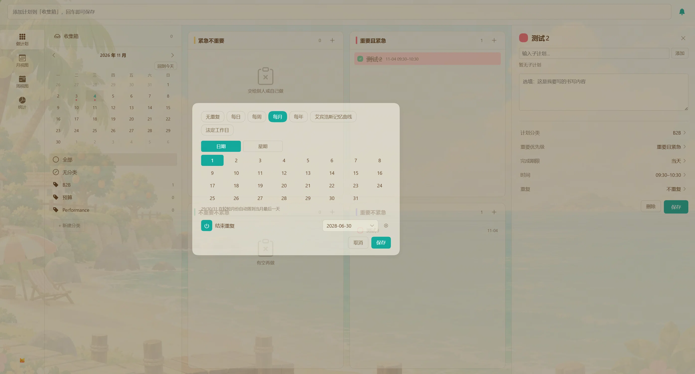

# dsh-quadrant-todo

DeepSeek Harness 的侧栏待办插件：管理日常工作的清单，数据和 agent 共用一份。

> 仓库、npm 包与插件标识统一为 `dsh-quadrant-todo`；DSH 侧栏显示的名字是「待办」。
> 尚未发布到 npm；仓库地址 https://github.com/ZIYE-JK/dsh-quadrant-todo

当前版本 **1.3.0**（四象限矩阵、周/月视图、统计、左栏状态与时间窗口筛选、子计划完成度与拖动排序、按开始时刻的系统与飞书通知 + 每日检查点、法定工作日与艾宾浩斯重复）。

## 界面

左栏四屏：**做计划**（四象限矩阵）、**月视图**、**周视图**、**统计**。

| 做计划 | 月视图 |
|---|---|
|  |  |

| 周视图 | 统计 |
|---|---|
|  |  |

重复设置（含法定工作日、艾宾浩斯记忆曲线，以及「每月最后一天」）：



## 兼容性

| 宿主版本 | 插件版本 | 结论 | 日期 |
|---|---|---|---|
| `0.2.2-rc.1` | `1.3.0` | 已验证可用 | 2026-11-11 |
| `0.2.2-rc.1` | `1.1.0` | 已验证可用 | 2026-11-09 |
| `0.2.2-rc.1` | `1.0.0` | 已验证可用 | 2026-11-06 |
| `0.2.1-rc.3` | `0.2.1` | 已验证可用（修复 0.2.0 的启动崩溃） | 2026-10-28 |
| `0.2.1-rc.3` | `0.2.0` | ❌ 启动崩溃，请勿使用 | 2026-10-27 |
| `0.2.1-rc.2` | `0.1.0` | 已验证可用 | 2026-10-22 |

`0.2.2-rc.1` 这一行的依据：宿主半的 HTTP 路由已确认注册并生效 ——
`POST /todo/api` 返回的是插件自己的守卫响应
`{"ok":false,"error":{"code":"forbidden"}}`（403），而不是 404 或宿主的登录页；
侧栏界面由使用者实测确认。

插件**不 import 任何 `@deepseek-ai/*` 包**（无 `dependencies`、无 `peerDependencies`），只依赖宿主在运行时提供的契约：

| 契约 | 用在哪 | 变了会怎样 |
|---|---|---|
| `window.__ModuleLoader__.load({ id, factory })` | `client.js` | 侧栏没有「待办」；**`id` 必须等于 `package.json` 的 `name`**，否则整窗无法启动（0.2.0 的事故） |
| `ctx.slots.inject / register` + 槽位 `sidebar.panellist` / `main` | 入口行与面板 | 入口消失，或点了不切换 |
| `ctx.webServer.register` + `ctx.connection.requestRejection` | `index.js` 路由 | 面板一直显示「读取失败」 |
| `ctx.tools.register` 的 `ToolDefinition` | `lib/tool.js` | agent 看不到 `personal_todo` |
| `ctx.locale.register / bind` | 文案 | 退化成只有中文（有兜底） |
| `--dsw-alias-*` 等主题 token | 样式 | 视觉降级，不会崩 |
| 数据文件 `todos.json` | `lib/store.js` | 与宿主无关，升级不受影响 |

**升级宿主后的自查顺序**：重载插件（`set_plugin` 关再开）→ 侧栏点开「待办」→ 让 agent 调一次 `personal_todo list` → `node --test`。

注意 `node --test` 覆盖 `lib/` 和 `client.js` 的一条静态约定（注册 id == 包名），宿主接口本身断了它照样全绿，所以前两步不能省。

## 安装

**从 npm**

> ⚠️ 尚未发布到 npm。包名已定为 `dsh-quadrant-todo`，发布前请走下面的 GitHub 方式。

```bash
dsh plugin --profile web add dsh-quadrant-todo
```

装完在侧栏「自动化任务」下方出现「待办」。也可以在宿主的 **插件 → 发现** 里搜 `dsh-quadrant-todo`（或「待办」），在市场里一键安装。

**从 GitHub 源码（当前推荐）**

```bash
dsh plugin --profile web add github:ZIYE-JK/dsh-quadrant-todo
```

适合想跟最新提交、或 npm 还没发到新版本时用；更新按 commit 追，没有版本号。

**本机开发**

把这个仓库目录直接装进 profile（链接方式，改代码即时生效）：

```text
plugin_manager install_bundle  target: <本仓库目录>
```

装了之后改 `index.js` 需要把插件行关再开才会重新加载模块；只改 `client.js` 会被 HMR 自动拾取。

## 数据在哪

默认 `%DSH_PROFILE_DIR%/data/dsh-todolist/todos.json`，普通 JSON，可以直接打开、编辑、备份。

```json
{ "version": 1, "todos": [ { "id": "t_...", "title": "交周报", "dueDate": "2026-10-22", "done": false } ] }
```

文件损坏时会备份为 `todos.corrupt-<时间戳>.json` 并以空清单启动。

## 配置

在 `cordis.patch.yml` 的插件行里改：

```yaml
- id: dsh-quadrant-todo
  config:
    staleDays: 7   # 超过多少天还没定日期算「积压」
    dataPath: ''   # 可选，覆盖默认数据文件路径
```

## 新建与编辑

- 「+ 新建」打开弹窗：标题、备注、日期、时间、优先级、分类、重复规则。
- 详情列底部「编辑」打开同一个弹窗，预填当前内容——**「未排期」的任务就是在这里排期的**。
- 弹窗顶部有一行「一句话填写」：输入「明天下午3点 交周报 #工作」，下面字段自动填好，再手动微调。
- 日期与时间是自绘选择器：月历（今天/明天/下周一快捷）与时/分两列，不受系统控件样式影响。

## 子计划

- 详情面板里一条条加；每条可单独勾选、可**拖动左侧 `⋮⋮` 手柄上下排序**（拖完即存，不用再点保存）。
- **完成度**按条数**均分**（5 条每条约 20%），显示在详情面板标题右侧（`3/5 · 60%`），矩阵行上也有一枚 `3/5` 小徽标。没有子计划时不显示，而不是 0%。
- **双向联动**，四向都生效：

  | 动作 | 结果 |
  | --- | --- |
  | 子计划全部勾满 | 主任务自动完成 |
  | 任一子计划取消 | 主任务取消完成 |
  | 主任务标记完成 | 子计划全部勾上 |
  | 主任务取消完成 | 子计划全部取消 |

  「取消主任务 → 子计划一起取消」不是多余的一步：双向规则下若不这么做，「全完成 → 完成」会立刻把主任务勾回去，来回弹。代价是取消主任务会清掉子计划的进度。
- 联动只在**非循环任务**上生效：循环任务的子计划是整个系列共享的，跟「某一次发生」没有对应关系。
- 手工把主任务标完成时，**不会**反过来覆盖你没做的子计划——反向只在你显式勾/取消主任务时发生（见上表）。

## 循环任务

- 重复方式：每天 / 每周（可多选周几）/ 每月（指定几号）/ 每年 / **法定工作日**（自动跟随中国调休）/ **艾宾浩斯记忆曲线**（1、2、4、7、15、30、60 天），可设结束日期。
- 列表里只出现**本周期待完成的那一次**：每天的当天出现、每周的整周可见、每月的整月可见。本次勾掉后这一行**保留并加删除线**（能立刻看出自己做过），下个周期自然回到未完成。
- 刚建的循环任务如果**还没到第一个发生日**（比如周三建「每周一」），会先显示下一次发生日，不会建完就看不见。
- 循环任务没写起始日时按创建日算，agent 只给 `repeat` 也能正常出现在列表与日历里。
- 勾选完成的是**这一次**（行上显示的日期），系列本身不受影响。
- 循环任务**不进「已完成」**，也**不参与「积压」**判定。
- **「每月 31 号」在短月自动落到当月最后一天**（2 月 28/29、4 月 30、9 月 30）；29/30 号在 2 月同理。选 31 号就等于「每月最后一天」。
- 在对话里说「每周一到周五 18 点交日报」，agent 会直接建好（`personal_todo` 的 `repeat` 参数）。

## 通知

顶部栏的喇叭图标里配置。系统通知与飞书通知两条通道可分别开关。

- **提醒时刻是「开始」**：时间段（09:30–10:00）在 **09:30** 提醒，时间点在那一刻提醒，全天任务在当天 09:00 提醒一次。
- **提前量** `leadMinutes`：比如设 5 分钟，10:00 开始的任务在 09:55 提醒，正文会写明「5 分钟后开始」。
- **逾期**：过了那一天之后每天提醒一次，不重复轰炸。
- **每日检查点**：默认 **11:00 和 16:00** 各发一条汇总，列出这个时间点之前该开始、但仍未完成的待办（含全天任务和前几天遗留的）。空列表不发。时刻可改，留空即关闭。
- 静默时段内不投递也不记账，等静默结束后再发。

```jsonc
"notify": {
  "system": true,
  "feishu": true,        // 需要 dsh-im 插件在同一宿主启用
  "leadMinutes": 5,
  "overdueDaily": true,
  "checkpoints": ["11:00", "16:00"],
  "quietHours": { "enabled": false, "start": "22:00", "end": "08:00" }
}
```

## 日历

页头切到「日历」看月视图：每格最多显示两条，多的收成 `+N`；点某天在右侧看当天安排，可以直接勾选，也可以「在这一天新建」。

## 分类

分类**不是预设的**，它来自待办里填写的分类名——某条待办写了新名字，这里就多一个。

- 弹窗里的分类是可输入的下拉，显示每个分类下有多少条。
- 页头「分类」打开管理弹窗：可以改名（已有待办批量跟随）、删除（退回「无分类」）。

## agent 工具

`personal_todo`，`action` 可选 `list` / `add` / `update` / `complete` / `confirm` / `delete`。

- `add` / `update` 接受 `repeat: { freq, weekdays?, monthDay?, until? }`；
- `complete` 接受 `date`（默认今天），循环任务用它指定完成哪一次；
- `list` 对循环任务标注「循环·本次 MM-DD」——即本周期待完成的那一次；`occurrences` 返回区间内全部实例。

工具会从口语里自行推断重复规则，不需要用户回答「你要哪种重复」。

## 一句话解析支持什么

日期（今天/明天/后天/周X/下周X/N天后/M月D日/月底）、时间（15:00、下午3点、中午、半夜）、
优先级（p1/p2/p3、!）、分类（#名称）。

规则：**一行只生成一条待办**，句子里第一个被识别的日期生效，其余原样留在标题里。

## 开发

```bash
node --test          # 143 个测试
node --check client.js
```

## 许可

MIT。`LICENSE` 里有两行版权：

```
Copyright (c) 2026 Natte      ← 上游 dsh-sidebar-todo 的作者
Copyright (c) 2026 ZIYE-JK    ← 本仓库
```

本项目从 Natte 的 `dsh-sidebar-todo@0.2.3` 起步，之后被大幅重写：界面、交互模型、
日历与统计视图、通知链路、法定工作日与艾宾浩斯重复、以及整套测试都是新增的。
上游的版权声明按 MIT 的要求保留（针对仍然派生自它的那部分代码），第二行覆盖新增工作。

> `LICENSE` 本身保持**逐字标准的 MIT 文本**——中间插入任何说明都会让 GitHub 的
> 许可证识别失败（显示 `NOASSERTION` 而不是 `MIT`）。所以这段说明放在这里。

